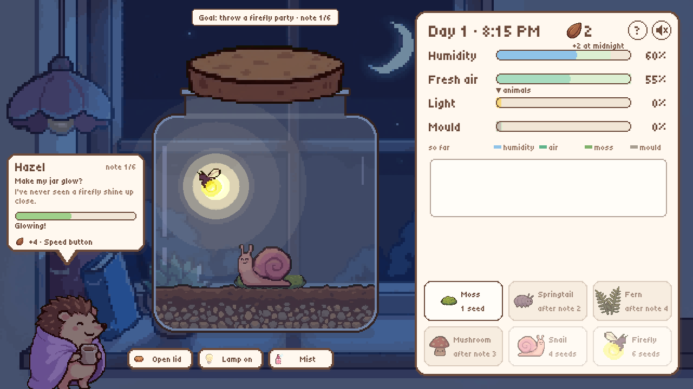

# 🫙 Jar Garden

**A tiny living world in a glass jar.** Moss, ferns, mushrooms, snails, springtails and fireflies keep each other alive, or don't. Open the lid, switch on the lamp, mist the glass, and watch the jar balance itself or slowly fall apart. Six neighbours on the windowsill send you little notes, and if you make their wishes come true, the jar ends in a firefly party.

Made solo for **Game Gauntlet: SIM Jam** (theme SIMULATION), Oct 19 – Nov 4, 2026.



## Try it

Play in the browser on itch.io: **[gianneangely.itch.io/jar-garden](https://gianneangely.itch.io/jar-garden)**. Works with mouse or touch, about 5–8 minutes to the party, then free play.

## Run locally

```bash
git clone https://github.com/GianneAngely/jar-garden.git
cd jar-garden
python3 -m http.server 8765
```

Then open http://localhost:8765. Opening `index.html` straight from disk also works (Canvas instead of WebGL).

URL flags: `?mute` turns off all audio, `?seed=N` gives a fixed jar, `?play` skips the title.

## What it simulates

- **Air and humidity** — moss and ferns make fresh air in the light, animals use it up. An open lid swaps air with the room but dries the jar.
- **Light and time** — the sun moves across the day. The lamp lets moss grow at night, but fireflies hate it.
- **Soil** — 20 patches, each with its own moss, leftovers and mould. Leftovers rot into mould when the jar is wet and still.
- **Food web** — snails eat leftovers then moss, springtails eat mould, mushrooms clean up, fireflies need moss, damp air and darkness to glow.
- **Life and death** — happy creatures have babies, sad ones lose health, bodies feed the mould.
- **Seeds** — every midnight each happy species pays a seed, and seeds buy new life.

Nothing is scripted. Every number on the panel shows its cause, and tapping a creature tells you how it feels and why.

## How to play

- **Pick, then place** — choose a creature in the shop, then tap inside the jar.
- **Open lid / Close lid** — fresh air in, damp out.
- **Lamp** — light at night.
- **Mist** — +10 humidity.
- **Speed** — 1x, 2x, 4x or pause (Space also cycles it).
- **?** — the jar guide: what every species needs, makes and eats.

## Built with

Phaser 3.90 · JavaScript · Python (Pillow) for the art pipeline · Playwright for tests

No build step: plain scripts loaded by `index.html`. Font: Tiny5 (SIL OFL). Music and sound effects are CC0, every one credited in [docs/AUDIO-CREDITS.md](docs/AUDIO-CREDITS.md).

**AI disclosure:** the illustrations were generated with Google Flow from my own style references, then turned into pixel art by `tools/make_pixel.py`. Code and text were written with AI assistance. The music and sound effects are not AI-generated.

## For developers

**Layout**

- `src/sim.js` — the simulation, pure JS without Phaser (rules in [docs/PLAN.md](docs/PLAN.md))
- `src/requests.js` — the six neighbour notes: goals, unlocks and the lose rule. `src/card.js` draws the note card and postcards
- `src/game.js` — the jar scene and UI. `src/title.js` — the title screen
- `src/pixel.js` — the pixel look for code-drawn UI (stepped boxes, whole-number sprite scales)
- `src/coach.js` onboarding · `src/fx.js` juice · `src/audio.js` music and SFX
- `docs/ONE-PAGER.md` — the game design

**Tests**

- `node tools/simtest.mjs` — balance scenarios for the sim
- `node tools/reqtest.mjs` — all six notes on one jar, 20 simulated players, the lose rule
- `node tools/test.mjs --http` — silent headless run through the UI, screenshots in `dist/shots/`
- `node tools/xbrowser/smoke.mjs` — Firefox and WebKit smoke test (first time: `cd tools/xbrowser && npm i && npx playwright install firefox webkit`)

**Build and media**

- `bash tools/build.sh jar-garden` — the itch zip in `dist/`
- `node tools/record.mjs tools/scenes/<name>.mjs out.gif` — frame-stepped GIF or MP4 of a scripted scene
- `python3 tools/make_pixel.py` then `python3 tools/px_fit.py` — Flow renders in `art/flow/pixel/` to pixel sprites in `assets/px/`. The room shows at 4x, the jar's contents at 2x
