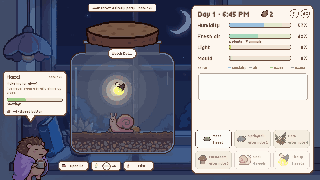
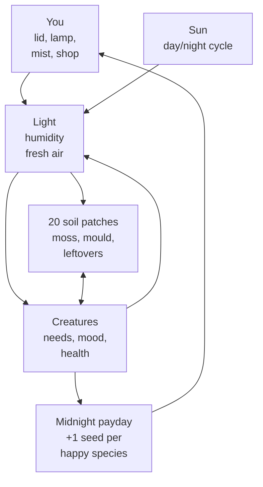
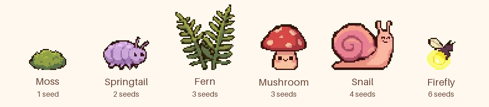
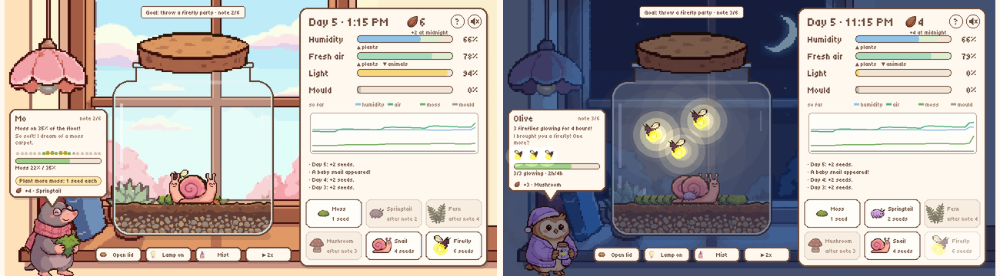
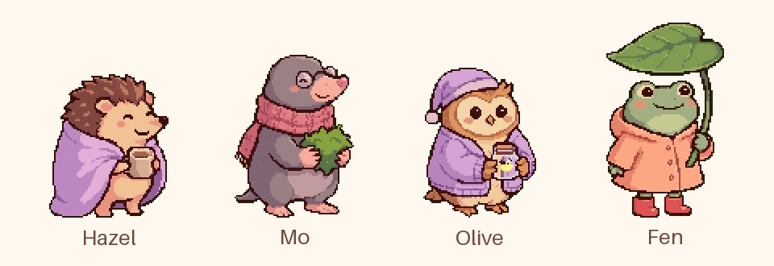
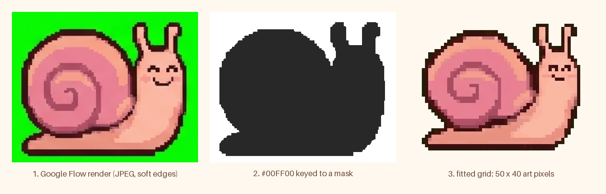

# 🫙 Jar Garden

**Keep a tiny living world in a glass jar alive, and make it glow.**

Jar Garden is a cozy ecosystem simulation that runs in the browser. Moss, ferns, mushrooms, snails, springtails and fireflies live in one sealed jar on a windowsill. They make air, eat each other's leftovers, rot and grow back, and nothing is scripted. You only have four controls: the lid, the lamp, a mister and a seed shop. Six neighbours send you little notes, and if you make their wishes come true, the jar ends in a firefly party.

Made solo for **Game Gauntlet: SIM Jam** (theme SIMULATION), Oct 19 – Nov 4, 2026.

**Play it:** https://gianneangely.itch.io/jar-garden &nbsp;·&nbsp; mouse or touch &nbsp;·&nbsp; about 8 minutes to the party, then free play



## How it works

The whole simulation is one pure function, `Sim.tick(state, dt)` in [`src/sim.js`](src/sim.js), with no Phaser inside, so Node can run it headless in the tests. One in-game day is 60 seconds at 1x and the game steps it about 120 times a day. Every step runs the same chain:



The jar's whole state is a handful of numbers:

| State | Range | Changed by |
| --- | --- | --- |
| `hum` (humidity) | 0–100 | lid, mist, moss and ferns, condensation on the glass |
| `air` (fresh air) | 0–100 | lid, moss and ferns in light, every animal, mould |
| `light` | 0–1 | the sun, the lamp |
| `slots[20]` | moss, mould, leftovers, each 0–1 | growth, spreading, eating, rotting |
| `ents[]` | position, health, food, age, mood | each creature's own rules |
| `seeds` | 0+ | midnight payday, the shop |

### 1. Light and time

The sun is up from 6 AM to 6 PM (0.25–0.75 of the day) and follows a half sine:

```
sun   = sin(π · (t − 0.25) / 0.5)      for 0.25 < t < 0.75, else 0
light = max(sun, lamp ? 0.7 : 0)
```

Everything that grows needs light above 0.15. Fireflies glow below 0.15, so the lamp grows moss at night but stops the light show.

### 2. Air and humidity

- **Lid open**: humidity drifts to the room's 40 at a rate of 1.2 a day and fresh air to 100 at a rate of 3 a day. Fresh air rushes in, but the jar dries out.
- **Lid closed**: humidity leaks 0.5 a day, and above 88 it condenses on the glass at `(hum − 88) × 2` a day, so a sealed jar can't drown itself.
- **Plants**: moss adds `2.0 × moss × light` air and `0.3 × moss` humidity a day; ferns add `1.6 × light × size` air.
- **Animals and mould** use air up. A snail breathes 2.5 a day, more than a fern makes, so a jar full of snails gets stuffy.

The panel shows the cause of every change. Each step records the air and humidity flow from every source (lid, plants, animals, mould, glass) and smooths it, so the ▲/▼ under each bar names the biggest push right now.

### 3. Soil

The floor is 20 patches. Each one keeps its own moss, mould and leftovers (dead leaves, bodies, nibbled moss):

- **Moss** grows logistically when humidity is 45–95 and there is light: `moss += moss × (1.05 − moss) × 1.4 × light`. Above 0.6 it spreads to a bare neighbour patch.
- **Mould** appears on a patch when the lid is shut, humidity is over 80 and leftovers pile up. It grows at `clamp((hum − 75) / 15, −1, 1)`, so damp still air feeds it and dry air shrinks it. An open lid kills it fast.
- **Mould smothers moss** at `mould × moss × 0.9` a day, and dead moss becomes leftovers that feed more mould. That is the loop a neglected jar falls into.
- Leftovers slowly turn into soil, at 4% a day.

### 4. The creatures



| Species | Eats | Gives / uses | Sad when | Babies | Max |
| --- | --- | --- | --- | --- | --- |
| **Moss** | light | air + damp | it dries (humidity < 30) or mould covers it | spreads to bare patches | 20 patches |
| **Springtail** | mould, then leftovers, then the film on old moss | uses a little air | humidity < 55 | often, when fed | 24 |
| **Fern** | stored sunlight | the most air, + damp | humidity < 50 or too dim | – | 4 |
| **Mushroom** | leftovers in its own and both next patches | clears mould around it | humidity < 55 | sometimes, when fed | 6 |
| **Snail** | walks to leftovers first, moss second | uses the most air | humidity < 45, air < 35, hungry | when fed, grown up and the air is fresh | 6 |
| **Firefly** | needs a moss carpet (15% of the floor) | glows in the dark | humidity < 50, too little moss, the lamp on at night | bought only | 6 |

Every creature with a reason to be sad loses 0.45 health a day. One with no reason heals 0.3 a day, and is **happy** above 0.7 health. Air under 20 makes every animal sad. Dead creatures drop leftovers where they fall. The reason is the bubble you see over a sad creature, so the game never hides why something is wrong.

### 5. Seeds

At every midnight each species with at least one happy member pays **1 seed**. Moss pays once it covers 25% of the floor. A balanced jar of six species earns six seeds a night, and a struggling one earns almost nothing. You can watch the seeds fly out of the creatures that earned them.

### 6. Reproducible

The random numbers come from a seeded mulberry32 generator kept inside the state, so the same seed and the same inputs always give the same jar. Add `?seed=42` to the URL to play a fixed jar, and `tools/simtest.mjs` checks it.



## The six notes



The neighbours turn the sandbox into a 5–8 minute arc on one persistent jar ([`src/requests.js`](src/requests.js)). Each note must stay true for a while (the *hold*), so a lucky moment doesn't count.

| # | From | Wish | Hold | Unlocks |
| --- | --- | --- | --- | --- |
| 1 | Hazel | Make my jar glow: one firefly glowing, lamp off | ~1 hour | 2x/4x speed |
| 2 | Mo | Moss on 35% of the floor | – | Springtail |
| 3 | Olive | 3 fireflies glowing (she brings one) | 4 hours | Mushroom |
| 4 | Fen | Mould under 1% after Fen drops soggy leaves in | 12 hours | Fern |
| 5 | Hazel | Every kind, nobody sad, lid shut | a whole day | – |
| 6 | Everyone | Party: 5 fireflies glowing, every kind here | 6 hours | the ending |

- **Onboarding without a tutorial wall**: note 1 holds the clock in the late afternoon until a firefly is in, and at night until the lamp is off. A slow reader still gets the first glow, and nobody can die during it.
- **Losing**: if no animal is alive for a whole day, the jar goes quiet. A card names the most likely cause from the last death and offers a rewind to the start of that note.
- **Saving**: the jar autosaves after note 1, at each finished note and at each midnight. The title then offers Continue.

## The art

The look is pixel art at whole-number scales: the room at 4x, everything inside the jar at 2x. The art started as Google Flow renders made from my own style references. Flow only *imitates* pixel art: an art pixel is 3–6 image pixels wide, the grid drifts and JPEG noise blurs every edge. [`tools/make_pixel.py`](tools/make_pixel.py) turns each render into true pixel art, one art pixel per PNG pixel:



1. **Key** the #00FF00 background to a binary mask.
2. **Pick the art pixel size**: use the clean lattice if the image has one (icons, logo), else assume the 320-px-wide frame Flow draws.
3. **Split** each sheet into sprites by connected components, and merge small bits into their neighbour.
4. **Fit a grid** per sprite with dynamic programming. It has exactly `round(size / pixel)` cells, and its cuts snap to real colour edges. Each cell takes its *dominant* colour, not the average, so thin dark line work wins at only 20% coverage.
5. **Quantise** to a small palette (32 colours for sprites, 48 for backgrounds) and clean single-pixel noise.

The jar, the glass, the panel and every card are drawn in code. [`src/pixel.js`](src/pixel.js) builds them from stepped boxes and circles on the same 4 px grid, so code-drawn UI and sprites share one pixel size. Text uses the Tiny5 pixel font, sized in steps of 8 px so it stays crisp.

## Sound

There are 20 sounds, each shipped as OGG and MP3: day, night and title music, day and night ambience, and SFX for the lid, lamp, mist, seeds, notes, postcards, unlocks, the win and the loss. All of them are CC0, credited one by one in [docs/AUDIO-CREDITS.md](docs/AUDIO-CREDITS.md). The music crossfades with the day/night cycle. `?mute` turns every sound off.

## Testing

All the balance work was done by running the sim headless, not by eye:

| Test | What it checks |
| --- | --- |
| `node tools/simtest.mjs` | 9 scenarios: a starter jar survives 15 days alone, an open lid dries the jar, a wet closed jar grows mould, cleaners cut mould, fireflies glow in the dark and dislike the lamp, crowded snails make the air stuffy, a balanced jar keeps 5+ kinds for 20 days, same seed gives the same jar |
| `node tools/reqtest.mjs` | each note with 20 simulated players. Engaged players finish (the whole arc: 20/20 won, median 3.9 in-game days, 0 deaths). Idle players, lamp-on players and only-misting players don't. Plus the lose rule, and that hungry cleaners never block a note |
| `node tools/test.mjs --http` | a silent headless Chrome run through the real UI, in Canvas and WebGL, with screenshots |
| `node tools/xbrowser/smoke.mjs` | the same smoke test in Firefox and WebKit |

## Run locally

No build step and no dependencies. Serve the folder:

```bash
git clone https://github.com/GianneAngely/jar-garden.git
cd jar-garden
python3 -m http.server 8765
open http://localhost:8765
```

Opening `index.html` straight from disk also works, with Canvas instead of WebGL.

| Flag | Effect |
| --- | --- |
| `?mute` | no audio at all |
| `?seed=N` | a fixed, reproducible jar that never saves |
| `?play` | skip the title |

The itch zip is built with `bash tools/build.sh jar-garden`, which writes `dist/jar-garden.zip`.

## What's inside

- **index.html**: loads Phaser and the scripts in order
- **src/sim.js**: the simulation (pure JS, runs in Node)
- **src/requests.js**: the six notes, holds, unlocks, the onboarding clock and the lose rule
- **src/game.js**: the jar scene: drawing, the panel and graph, the shop, input
- **src/card.js**: the note card and the postcards
- **src/coach.js**: the 30-second onboarding arrows
- **src/fx.js**: cozy juice and sim tells (soil puffs, seed fly-outs, glows), no screen shake
- **src/pixel.js**: stepped pixel shapes for code-drawn UI
- **src/audio.js**: music beds, crossfades, SFX
- **src/title.js**, **src/guide.js**, **src/config.js**, **src/main.js**: the title, the jar guide, constants and save, boot
- **assets/px/**: the pixel sprites and backgrounds, **assets/audio/**, **assets/fonts/**
- **tools/**: tests, the art pipeline, the build, and the GIF/MP4 recorder (`record.mjs` steps scripted scenes frame by frame)
- **docs/**: the design ([ONE-PAGER.md](docs/ONE-PAGER.md)), the plan with the sim rules ([PLAN.md](docs/PLAN.md)), milestone notes and the images in this README

## Built with

Phaser 3.90 · JavaScript · Canvas / WebGL · Python (NumPy, Pillow) · Google Flow · Playwright · itch.io

Plain JavaScript files: no framework, no bundler.

## Credits and AI disclosure

- Engine: Phaser 3.90 (MIT). Font: Tiny5 (SIL Open Font License).
- Music and sound effects: CC0 works by MintoDog, Aureolus_Omicron, Joseph Sardin / BigSoundBank, isaiah658, Kenney, Vehicle (Jan Schupke), OwlishMedia and Spring Spring. The full list with links is in [docs/AUDIO-CREDITS.md](docs/AUDIO-CREDITS.md).
- **AI disclosure**: the illustrations were generated with Google Flow from my own style references, then rebuilt into pixel art by the pipeline above. Code and text were written with AI assistance. The music and sound effects are not AI-generated.
